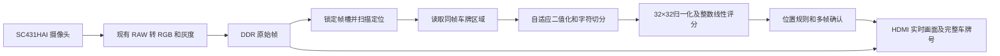

# Ti60 纯 FPGA 蓝牌实时识别设计

初稿日期：2026-10-16；需求更新：2026-10-18。识别必须在 FPGA 上完成，运行时脱离电脑。现已建立离线参考模型，[G1真实样本记录](../validation/blue-plate/g1-20261018.md)尚未通过；FPGA识别与整机集成尚未实现。[帧接口与资源约束](blue-plate-g1-interface.md)用于后续实现审核。

## 当前确认范围

用户已确定：持续显示摄像头实时彩色画面，识别到完整蓝牌时，在 HDMI 画面上显示完整车牌号。只做普通单行蓝底白字七位车牌，包含省份汉字、字母和数字。

2026-10-18 用户已确认首轮上板验收范围：受控机位、清晰完整无遮挡的单个普通蓝牌。首轮检查真实摄像头彩色视频连续、七位真实号码上屏、来源一致和过期清除；遮挡拒识留作后续改进，不再作为独立硬件接口或受控首版推进的前置条件。31省全覆盖与复杂道路场景不增加为首轮必过项；原字典支持范围保留。该决定不放行未验证量化模型，也不授权板卡烧录。

本次不建设照片保存、录像、历史记录、车辆事件管理或历史对比系统，不支持新能源绿牌。已有边缘演示工程的保存和回放功能不因本次需求确认而删除；车牌功能不接入这些操作。

默认显示行为建议为：未得到可靠的七位结果时显示“未识别”；完整结果确认后显示号码；目标离开或结果过期时清除号码，避免把上一辆车的号码显示成当前结果。确认次数和失效时间属于待样本验证的实现参数。

DDR 仍可用于实时处理的临时帧缓存，不提供照片或识别结果留档。固定机位沿用既有要求，具体距离、倾角和速度范围通过实拍验证确定。

当前离线主候选采用蓝色轮廓定位、二值行跳变筛选、字符投影切分和整数线性分类，后续接入多帧确认。复用 SC431HAI、画质处理、DDR 和 HDMI；分类核已有独立验证，定位、切分和整机识别尚未接入。候选与复现记录见[普通蓝牌候选记录](../validation/blue-plate/normal-data-candidate.md)。

2026-10-18 已补充[开源实现对照与改进候选](blue-plate-research-20261018.md)：局部阈值、汉字独立归一化、笔画分布特征、蓝色候选优先及车牌专用构建评估。以下算法参数仍为基线；候选需经同样本比较后再决定是否进入 RTL。

## 首版识别条件

首轮面向受控机位下清晰完整无遮挡的单个普通蓝牌。模型字典仍支持31个省级简称、24个常用车牌字母和数字0—9，不能只录入演示号码；字典支持不等于首轮必须完成31省实拍全覆盖。距离、倾角和速度范围随实际验收材料记录。

初始测试条件设为：720p 图像中车牌宽约 160—300 像素，字符高度至少 32 像素，接近正视，横滚角在 ±5° 内，无严重遮挡或过曝。上述范围是待实拍验证的设计输入。框选缓存最大支持 320×96，包含少量边界余量；超出范围明确提示调整距离。

新能源绿牌不在当前任务范围内，也不预建相关分支。双层牌、多车同屏、夜间强反光和大角度透视不作为首版支持目标。

## 技术依据与取舍

| 参考 | 实际阅读内容 | 结论 |
|---|---|---|
| [EasyPR](https://github.com/liuruoze/EasyPR) | `src/core/plate_locate.cpp` 的 `colorSearch`、`sobelOper`；`chars_segment.cpp` 的 `charsSegment`；`chars_identify.cpp` 的 `classify` | 定位结合颜色、Sobel 和形态学；字符需去边框/铆钉，汉字单独处理；按字符位置约束候选。其 OpenCV/ANN 实现不能直接作为 RTL 使用。 |
| [DOUDIU FPGA 参考](https://github.com/DOUDIU/Vehicle-License-Plate-Recognition-on-FPGA) | `plate_feature_recognize.sv`、`conv_template_match.sv`、`VIP_vertical_projection_char.sv` | 8×5 二值网格、顺序模板评分和列投影可以用硬件实现；代码将分隔点作为单独槽位跳过，不能把八个槽位误认为支持八字符新能源牌。源码中的变量除法和 10 位横坐标也不能直接移植到本项目。 |
| [jjejdhhd FPGA 参考](https://github.com/jjejdhhd/License-Plate-Recognition-FPGA) | `Get_EigenValue.v`、`template_matching.v`、`char_vertical_projection.v` | 使用网格特征和 XNOR 匹配；当前匹配数组只比较 2 个汉字、7 个字母及 11 个混合字符，不能据此认定已支持通用车牌。 |
| [Efinix TinyML](https://github.com/Efinix-Inc/tinyml/blob/main/docs/faq.md) | Ti60F225 资源表 | 官方人物检测示例整机占用 57100 XLR、239 RAM；它证明 Ti60 有 AI 路线，但不是车牌模型的资源估算，也不能直接叠加到当前整机。 |

前三者提供了可以分析的实现。两个 FPGA 仓库本次没有完成独立构建、准确率复测或板上复现，因此作为实现参考，不当作本项目已验证的性能依据。

下载材料存放在 `tmp/plate-research/`，包括上述九个核心源码文件、官方 FAQ、两个仓库文件树和 FPGA 源码 URL 清单 `sources.json`。PowerShell/curl 的 TLS 凭据调用失败后，使用 Python HTTPS 成功获取。只读取材料，没有执行第三方脚本，也没有复制代码进产品 RTL；采用第三方代码前需单独核对许可证。

早期 XOR 多模板基线已通过同图比较，被整数线性分类替代。线性模型的 320 项输入特征、65 类打分和复用乘法单元适合顺序实现；当前主要损失仍来自自动定位、切分及置信拒识。字符核与整牌识别分别验收。

## 数据流

识别任务从已完成写入的原始帧读取 RGB/灰度数据。定位和后续区域读取都持有同一个帧槽，任务完成或失败才释放，避免上一帧的框裁到下一帧车辆。复用已有 DDR 控制器和 DMA，新增任务仲裁，不另建内存控制器。

车牌任务不经过 `shape_recognizer` 的全帧连通分量和轮廓遍历，也不依赖 Canny 滞后连接。当前 `frame_store.v` 把形状识别接在边缘完成之后，不能直接把车牌模块串在其后。

### 1. 车牌定位

当前离线参考在完整 720p 图像上做 HSV 蓝色筛选、小窗口闭运算和轮廓提取，使用四边形或旋转矩形得到 224×64 候选板面，再按 Otsu 二值行跳变筛选文字区域。它使用 OpenCV 浮点几何，尚不等价于硬件。原先色差与行列投影的硬件简化路线要与冻结候选逐图比较后才能替换。

最多保留两个候选带，按颜色覆盖、边缘密度、宽高比和尺寸评分，首版输出一个车牌。几何筛选采用整数乘法比较；阈值由实际相机样本确定。颜色和边缘应分别统计并联合评分，不能逐像素简单相与，因为白字边缘本身未必满足蓝色条件。

定位阶段可降采样，但切分和识别必须回到原始 720p 区域。用于找车牌的闭运算结果不用于字符 OCR，防止笔画粘连。

### 2. 二值化和切分

先遍历候选区域生成灰度直方图，采用 32 档 Otsu 选择阈值；再读取同一区域，生成二值字符图。Otsu 由复用的多周期整数运算器执行，不展开成每像素除法器。位宽、空直方图和两类中任一类为空时的行为必须在参考模型中明确。

原始灰度仍保存在 DDR，片上只保存最多 320×96 的二值区域和统计量。区域有明显照度梯度时，先对比局部分块阈值的实拍结果，确认有效后再增加硬件。

去除上下边框、铆钉和分隔圆点；行投影找字符高度，列投影找字符间隙，结合高度和间距得到七个字符。省份汉字不能按连通分量直接切割：左右结构可能断开，应结合第二个字母的位置及预期字宽确定首字符区域。切分数量或几何关系异常时返回切分失败，不强行均分七格。

当前参考使用四角透视采样，固定投影窗口内必须存在实测空谷。右边框只有在已有六个前序文字连通块、且额外边缘块间距不足正常字距时才删除，避免抹去偏移后的末位“1”。定点几何与逐列偏移替代方案尚未验证。

### 3. 字符分类

切分确定字符框后，从原灰度 ROI 重新执行 32 档 Otsu。原始二值字符只归一化一次：裁前景包围框，保留长宽比装入 28×28，再居中填充为 32×32。尺寸使用整数半入舍规则，采样坐标向下取整。重复归一化会改变笔画，禁止把已归一化输入再交给 `predict()`。

特征依次为 256 个 2×2 网格和乘 8、32 列投影、32 行投影，共 320 个 0—32 整数。65 类线性分数由 signed10 权重与 signed32 偏置累加，使用 signed32 累加器；同分取较小类别 ID。第一位限 31 省，第二位限 24 字母，后五位限 34 英数字，接受条件同时检查最佳分数与不同类别分差。

模型、ID、普通/严格门限与归一化契约以 `tools/blue_plate/char_model/candidate/interface.json` 为准。空白或分数/分差不足时拒识；分数不是概率。权重来自有许可的训练字符，训练身份元数据不完整，不能宣称与最终场景隔离。显示字库独立于识别权重。

### 4. 结果确认与显示

输出车牌字符 ID、字符数、定位框、各字符分数和分差、状态及来源帧号。低分或不合规则的结果标记为“未确认”。候选框属于同一目标，且连续三次有效识别一致后，才显示确认结果；候选中断、目标跳变或超时应重置连续计数。

HDMI 持续展示实时彩色画面，在固定结果栏显示完整车牌号或“未识别”。无需按键触发识别、保存或回放。裁剪图、二值图和字符切分结果用于开发调试，不作为首版用户操作流程。结果按显示帧边界原子更新，通过现有 mailbox 方式跨时钟域。

首版只叠加固定号码栏，不要求绘制定位框。开发时如显示定位框，必须使用结果对应的帧，避免把旧框贴到新位置。目标消失或结果过期后清除号码和确认状态，防止旧车牌长期残留；具体失效时间通过样本验证确定。

## 工程接入与资源

当前项目以 `coding/edge-quality-30fps/` 为基础。关键接入点为：

| 位置 | 计划改动 |
|---|---|
| `rtl/ti60f225_oob_top.v` | 接入车牌模式与结果，沿用现有 RGB/灰度和三时钟域边界 |
| `rtl/frame_store.v`、控制与 DMA 模块 | 增加车牌任务、源帧持有、区域读取和错误释放；显示读取仍有期限保障 |
| 新增 `plate_locator.v` | 候选颜色、边缘、投影和定位 |
| 新增 `plate_recognizer.v` | 区域二值化、切分、归一化、线性分类和任务状态机 |
| `rtl/threshold_osd.v`、`edge_ui.v` | 车牌字库、实时号码栏及车牌模式入口 |
| 测试、工程 XML 与 ROM 文件 | 定点参考、测试向量和权重/显示字库初始化文件 |

已有像素任务接口每拍包含两个像素。新模块须保持吞吐，或用 ready/valid 正确串行化 DDR 读流，不能丢掉第二个像素，也不能反压无停顿能力的相机入口。

截至2026-10-18，冻结版本 `0x60101704` 的验证记录为49156/60800 XLR、188/256 RAM、111/160 DSP。对应 `release/manifest.json` 的逻辑余量要求为19%，其余为20%；来源见[任务8构建记录](../validation/edge-quality-30fps/task8-keys-20261017.md)。本轮没有重新综合，不能把此前构建的48479 XLR等数字继续作为当前基线。

按上述余量要求计算，当前额外预算约92 XLR、16块RAM和17个DSP。物理剩余资源不等于可自由使用的工程预算，当前逻辑预算不足以直接叠加完整车牌模块。

因此建议先验证车牌模块的独立资源，再尝试集成。若保留全部功能无法通过预算，采用共享源码的车牌专用构建，在综合时裁除未使用的 Canny/形状识别逻辑；运行时关闭功能不会释放硬件资源。这个构建取舍属于实施前需确定的事项，不能静默删除已有功能，也不通过取消资源检查掩盖超预算。

初始存储核算：

| 内容 | 原始容量 |
|---|---:|
| 二值区域 320×96 | 3840 字节 |
| 65 类×320 signed10 权重及 signed32 偏置 | 有效位紧密打包为 26260 字节；实际软件 int16 权重为 41860 字节 |
| 七个 32×32 二值字符 | 896 字节 |
| 65 个 16×32 显示字形 | 4160 字节 |
| 合计，不含特征缓存、行缓存、投影、直方图与 FIFO | 紧密打包口径 35156 字节 |

综合分配受 RAM 位宽、深度和端口限制，不能把总字节数简单除以 RAM 容量当作最终块数。车牌模块初步预算上限取 6000 XLR、28 RAM、8 DSP，用于设计约束，最终以 Efinity 布局布线为准。

当前独立分类核遍历 65 类，每字 20800 次乘累加；320 项特征输入后固定 41796 拍产生结果，七字计算 292572 拍。100MHz 仅为约束目标，不能将理论 2.926ms 当整机延迟。Efinity map 为 33 RAM、1 DSP；详见[分类核验证](../validation/blue-plate/char-model/rtl.md)。33 RAM 已超过早期整块车牌模块的 28 RAM 设想，应以新的精简视频底座与整机综合重新审核分配，不能默默抬高总资源上限。

## 脱离电脑运行

当前 `load.cmd` 在 JTAG SRAM 加载后，调用 `control.cmd` 设置处理参数，并通过 `--sensor-restore` 恢复摄像头参数。首版独立运行必须将确认后的图像、曝光、增益和模式默认值写入板上的复位逻辑及 I²C 初始化表，不能依赖这两次主机命令。

交付验收需包含非易失配置启动：核实板卡配置 Flash 和启动模式，验证“断电 → 拔掉电脑连接 → 独立供电 → 摄像头初始化 → 显示并识别”。本轮没有烧写 Flash。离线生成模板、仿真和综合可以使用电脑，运行时只需板卡、摄像头、电源和显示器。

## 实施顺序与验收

1. 建立实拍样本和定点参考模型。先用手工标注区域验证二值化、切分和字符匹配，再验证自动定位；手工区域只是定位诊断手段，不是最终识别入口。
2. 验证陌生车牌。开发、阈值校准和最终测试按车牌身份及拍摄场次分离，不能把同一段视频相邻帧分到不同集合。测试需覆盖完整字符集，并统计易混字、不同距离、轻微倾斜和负样本。
3. RTL 与定点参考逐像素、逐字符对照。重点覆盖汉字左右结构、分隔点、边框、字符粘连、无车牌、模糊、同类多模板分差及位宽溢出。
4. 在整机加入 DDR 竞争、帧槽复用、跨时钟结果、任务超时和复位测试。结果失败必须释放帧槽；识别繁忙时跳过新的识别任务并计数，采集与显示不得被阻塞。
5. 布局布线核对资源和时序，再上板测实际识别效果，最后验收独立上电启动。

建议首版目标：采集保持当前约 30fps，HDMI 保持原有输出刷新率；对新帧每秒完成至少 10 次识别，目标进入有效范围后 500ms 内得到确认结果。相同冻结帧反复计算不能计作新的识别吞吐。

在约定首版条件下，建议用至少 100 个独立车牌样本、300 段无牌或干扰场景进行测试，目标为整牌完全正确率 ≥95%，负样本错误确认率 ≤1%。测试集对全部字符及易混组合应有额外覆盖；这组数字是验收目标，不是已有性能。

整牌正确率的分母包含漏检和拒识，七位必须全部正确；另外分别记录定位成功率、切分成功率、拒识率和错误确认率，避免靠大量拒识抬高准确率。按车牌或事件统计，不能把同一辆车的几千帧当作几千个独立样本。

当前继续按真值区域和自动区域拆分损失：定位或切分错误修相应阶段；正确字符区域仍混淆时由字符窗口复核模型。产品只接入获准的单一分类内核，研究脚本中的历史模板模式仅保留用于复核历史对照。

## 当前实施边界与验收

2026-10-18 的需求收缩取代此前车辆看护、照片留存及事件回看提案。当前只实现自动识别与实时号码显示；不实现自动拍照、三条历史记录绑定、32帧事件回看、触发前后缓冲、记录覆盖策略或非易失留档。

用户可见的验收动作：

1. 摄像头持续显示实时彩色画面，识别计算期间画面仍更新。
2. 将完整蓝牌放入有效范围，系统自动识别并显示七位号码，包含省份汉字。
3. 更换为另一张蓝牌，确认结果后显示新号码。
4. 无车牌、车牌不完整或无法可靠识别时，不显示猜测号码；目标离开或结果过期后清除旧号码。
5. 脱离电脑独立上电后，能够自动进入实时识别显示。

当前技术路线为蓝色候选、二值跳变验证、字符切分、整数线性分类与短时结果确认。准确率、吞吐和识别距离仍为设计目标；当前离线结果未通过 G1。先改善真实蓝牌端到端效果，再开展定位/切分 RTL 与整机集成。
