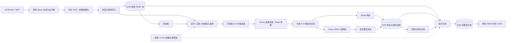

> 历史技术记录。仅说明记录时的版本；当前操作与状态以 [使用指南](../../../docs/for-reader/usage.md) 为准。文中旧路径用于溯源，不是当前运行入口。

# 赛题四：实时图像边缘检测系统总体设计

版本：2026-10-10，设计稿。用户已确定覆盖基础要求和全部高阶挑战。本文件中的新增功能、资源预算及性能指标均为设计目标，尚未实现或上板验收。

## 1. 最终系统

系统以全视野实时视频为主画面，支持灰度、Sobel、Canny、去噪对比、彩色边缘叠加和圆形／矩形识别。板载按键完成日常操作；JTAG 用于精确设置、状态读取及自动验收。所有算法在 FPGA 内执行。

采集沿用已验证的 2560×1440 RAW10 约 30fps，经现有 Bayer 合成和白平衡得到 1280×720 RGB。图像算法处理完整 1280×720；HDMI 固定 1280×720@60Hz。全功能实时处理目标为 30fps，Canny 与识别的最终吞吐量必须实测。全分辨率 60fps 摄像头配置不作为本设计的前置条件。

默认开机进入“灰度／Sobel 对比”，阈值为项目标定值，中值滤波开启；模式切换无需重新下载位流。保留彩色直通模式用于校准和故障定位。项目标定值在测试图和真实场景完成验证后写入，不在设计阶段虚构最佳阈值。

## 2. 架构



局部算法在实时输入上逐像素流水处理，不等整帧到齐再开始灰度、滤波或梯度计算。Canny 的全局连接、识别和显示合成消费已完成的帧。冻结及回放通过 DDR 读取接入同一个算法入口。

复用同一个梯度计算模块处理当前选择的 Sobel 或 Canny。各流水级使用同一种 3×3 窗口模块，但需要独立的行缓存实例，不能让不同流水级争用同一个窗口状态。实时和冻结重处理互斥使用算法流水线。

完整 Canny 采用帧级连接，是支持任意长度弱边链所需的结构；其耗时单独计量。基础局部算法保持行流水线特征，系统总延迟按实测报告。

## 3. 复用边界与模块职责

| 模块 | 处理方式 | 职责 |
|---|---|---|
| 摄像头初始化、CSI、`raw_full_view.v` | 复用 | 保持完整视野、已验证曝光与白平衡；不重做 60fps 试验 |
| DDR 控制器与现有 AXI/FIFO 打包逻辑 | 复用并扩展上层访问 | 保留物理接口、校准及时序；增加采集、全帧处理、合成和显示的访问仲裁 |
| `bank_switch.v` 上层帧管理 | 改造 | 当前只处理读写银行；升级为完整帧发布、处理占用、冻结引用及回收 |
| 像素处理 | 新增 | 灰度、中值、高斯、梯度、Sobel、NMS；固定数据宽度和边界规则 |
| 全帧边缘处理 | 新增 | Canny 连接、边缘连通域遍历；共用邻域访问和队列设施 |
| 形状分类 | 新增 | 对候选轮廓计算几何特征，输出类别及包围框 |
| 显示合成、OSD、控制寄存器 | 新增 | 统一视图、状态、按键和 JTAG 操作 |
| HDMI 编码及时序 | 复用 | 始终输出 720p60，读取完成的显示帧 |

按以上职责组织 RTL，不另建通用算法插件框架。复用现有 Python/JTAG 控制脚本并增加必要命令，暂不增加 RISC-V、操作系统或桌面 GUI。

## 4. 像素和帧的一致性

核心算法域计划沿用 100MHz，1 个有效像素／周期；当前 MIPI 像素域为 50MHz，每次提供两个 RGB 像素，跨域 FIFO 后按顺序解包。HDMI 像素域为约 74.25MHz。摄像头不可反压：FIFO 满或没有可写帧时明确记录整帧失败，禁止把残缺帧发布出去。

可停顿的像素接口统一为 `data / valid / ready / sof / eol`，状态只在 `valid && ready` 时前进。帧描述符保存 `frame_id、capture_timestamp、config_epoch、width、height、完成标志、引用状态`。图像数据跨域用异步 FIFO；描述符和多位参数用握手快照，不能逐位双触发器同步后直接使用。

- 每帧开始时锁定一份参数。按键修改先进入待提交参数，下一个任务边界生效。
- 图像、边缘、识别框和图像上的参数标签必须属于同一 `frame_id + config_epoch`。
- 显示合成只发布完整结果；HDMI 只在垂直消隐期间切换显示帧。
- 采集、算法、合成和显示各自持有帧引用，所有引用释放后才能覆盖对应内存。
- 30fps 图像在 60Hz HDMI 上允许重复显示；重复显示与采集丢帧、算法跳帧分别计数。
- 默认实时模式按帧顺序处理。负载过高时保留最后一个完整画面并显示处理超时，统计未处理帧；不能把跳帧包装成达到 30fps。

显示帧采用三缓冲；实时原帧先配置四个槽位，覆盖正在采集、等待处理、处理占用和显示引用，依赖计数决定实际回收。冻结时停止向算法提交新的实时帧，但摄像头接收继续排空并保留健康统计，主动忽略的帧按冻结状态单独计数。

## 5. 算法定义

### 灰度、滤波与 Sobel

- 灰度选用 `Y = (77R + 150G + 29B + 128) >> 8`，输入输出均为 8 位；常系数移位加法或 DSP 实现。
- 中值滤波对九个 8 位像素排序，输出严格的第五个值。用固定比较交换网络；旁路时维持坐标和有效信号一致。
- Canny 高斯核使用 `[[1,2,1],[2,4,2],[1,2,1]] / 16`，固定四舍五入规则。Canny 高斯始终存在，中值是可选的额外椒盐去噪。
- 梯度采用任务书的 3×3 Sobel 核。`Gx/Gy` 使用至少 11 位有符号数；`|Gx|+|Gy|` 保留 11 位，不先截断到 8 位。
- Sobel 二值判定为 `G > T`；阈值范围 0～2040，调整步长默认 16，饱和到上下限，不回绕。
- 各局部算子使用复制边界，保持输出尺寸。最终最外圈一像素强制非边缘，防止画面边框成为检测目标。每级的填充、舍入和最终边界策略写入参考模型。

### 完整 Canny

流程为：灰度 → 可选中值 → 3×3 高斯 → 梯度幅值／方向 → 非极大值抑制 → 双阈值 → 八邻域滞后连接。

方向量化为四个方向，用整数交叉比较实现，等号方向固定。NMS 对平台采用固定方向的非对称等号规则，避免两侧同时保留；这些细节先在位精确参考模型中定义。

屏幕提供高阈值 `Th` 和比例 `r` 两个参数，默认 `r=1/2`，`Tl=floor(Th*r)`；可选择 `1/4、1/2、3/4`。`Th` 范围 1～2040。强边为 `G>Th`，弱边为 `Tl<G<=Th`。零梯度始终不成为边缘。

滞后连接采用 DDR 状态图和坐标工作队列：

1. 局部流水线写入非边、弱边、强边分类。分类帧完成后，全帧处理者扫描该帧，将强边标为已接受并把其坐标放入队列。
2. 种子扫描完成后，顺序取出坐标，检查合法的八邻域。
3. 邻居若为未访问弱边，先更新接受状态，再入队；每个像素最多入队一次。
4. 队列耗尽后，接受集合就是最终边缘；不与任何强边连接的弱边全部删除。

坐标工作队列容量按 `1280×720` 个条目配置，每项32位。M09实现采用后进先出遍历，状态图压缩为每像素2位，并为三个结果槽各保留独立平面。单一处理者串行更新状态，先标记再入队，避免重复；状态缓存与坐标队列均使用突发传输。同一时刻只处理一个帧任务，队列清空且缓存写回成功后发布，显示端合成接受位与RGB。地址和位精确规则见完整Canny记录（历史路径：`edge-m09-canny.md`）。

该算法有明确终止条件和像素数上界，能保留迂回跨行的弱边链。吞吐量随边缘密度和 DDR 访问效率变化，必须用真实视频与压力图测量，不能仅凭 100MHz 推断 30fps。官方 Canny 连接语义参见 [OpenCV 文档](https://docs.opencv.org/4.10.0/da/d22/tutorial_py_canny.html)。

### 圆形与矩形识别

输入来自当前选择的最终边缘图，最多显示四个目标。采用连通域候选、闭合轮廓跟踪和几何判定，复用邻域读取及坐标队列。识别遍历使用独立访问标记，不修改最终边缘图。

- 首先排除太小、触边、未闭合或分叉严重的候选。统计轮廓包围框、边界点及闭合情况。
- 跟踪有序闭合轮廓，计算多边形面积和周长。面积不能用边缘像素数量替代。
- 矩形通过轮廓折线近似、四个主要角点、近似直角与边到直线的残差共同判断，支持平面内旋转。
- 圆形通过径向残差、圆度及包围框长宽比共同判断，不能仅凭近似正方形包围框分类。
- 超出几何容差显示未识别；候选多于四个时显示筛选后的四个，并提示数量超限，不把漏掉的候选当成不存在。

首版验收场景为纯色背景上的分离、完整、高对比度印刷圆形和矩形；720p 图像中目标短边／直径 64～400 像素，距离画面边缘至少 16 像素，无相互接触和遮挡。三角形、椭圆和开放折线作为负样本。几何容差由开发样本标定，在独立验收样本上测准确率。框和类别与图像同帧发布，不把上一帧识别框叠到当前视频上。

## 6. 显示设计

画面以视频为主，默认不显示开发日志或寄存器地址。使用固定宽度小字体和简单矩形，深灰信息区、白色常规文字、青色选中项；红色只用于边缘叠加或错误，冻结以文字明确标注。中文标签使用小型固定字库，数字与英文复用 ASCII 字库。

| 视图 | 画面安排 | 用途 |
|---|---|---|
| 彩色 | 1280×720 完整原图 | 摄像头和颜色基准 |
| 灰度 | 1280×720 原始灰度 | 验证灰度与亮度 |
| 边缘 | 1280×720 黑底白边 | 检查 Sobel / Canny 轮廓 |
| 对比，默认 | 左原始灰度、右当前算法边缘 | 基础要求与算法演示 |
| 去噪 | 左原始灰度、右中值输出 | 同帧去噪效果比较 |
| 叠加 | 原始 RGB + 红色最终边缘；可加识别框 | 最终展示 |

对比视图使用两个 640×360 完整视野，坐标分别为 `(0,180)` 和 `(640,180)`。同一映射分别作用于两图，无裁剪、无拉伸。边缘图缩小采用 2×2 OR，避免单像素边缘被抽样丢失；灰度和彩色使用 2×2 平均。全屏边缘模式用于检查真实像素宽度。

```text
┌─────────────────────────────────────────────────────────────┐
│ 实时 / 冻结 / 回放    Sobel / Canny    采集 FPS    处理 FPS   │
│                                                             │
│        原始灰度 640×360          最终边缘 640×360             │
│        完整视野                 同一帧、相同比例             │
│                                                             │
│ 视图  算法  阈值  去噪  识别  帧操作     选择 / − / ＋       │
└─────────────────────────────────────────────────────────────┘
```

全屏模式使用窄幅半透明状态条，不缩小主图；支持隐藏 OSD 检查全图。冻结后显示的 FPS 为实时采集和实际完成处理计数，不能将 HDMI 的 60Hz 标成算法 60fps。选项已修改但结果尚未完成时显示“应用中”，旧画面旁继续保留旧参数。

不常驻四宫格，也不同时计算两个完整算法。Sobel/Canny 的公平比较通过冻结同一原图切换算法完成；去噪前后边缘对比也使用同一冻结帧和固定阈值。

## 7. 操作与状态

现有 KEY0 已接入系统复位，保留其含义。V4 原理图有 KEY1～KEY3；工程尚需添加这些 GPIO 输入并在实施时逐键验证。

| 操作 | 行为 |
|---|---|
| KEY1 短按 | 选择下一项；释放时确认短按 |
| KEY2 / KEY3 短按 | 当前项减小／增大，枚举项切换 |
| KEY1 长按 800ms | 冻结当前完整显示帧对应的原图；再次长按恢复实时 |
| 阈值项长按 KEY2 / KEY3 | 500ms 后以 100ms 间隔连续调整；枚举项不连发 |
| KEY0 | 系统复位，恢复项目默认参数 |

按键采用同步和约 20ms 消抖；长按触发后不再补发一次短按。每个页面底部显示当前三个键的含义。独立按键与 JTAG 写入经过同一配置提交逻辑；同周期冲突固定优先级并返回实际生效值。

选项顺序为：视图、算法、阈值、Canny 低阈值比例（仅 Canny 显示）、去噪、识别、帧操作。焦点位于“帧操作”时，KEY2/KEY3 选择取消、录制、回放、回放暂停、单步、设为参考帧或返回实时；此时 KEY1 短按执行选中动作并返回“视图”项，底部按键提示改为“执行 / 上项 / 下项”。其他字段中 KEY1 仍表示选择下一项。

### 冻结、回放、多帧对比

- 冻结锁定“当前正在显示的源帧”，同时保留图像和结果。冻结后调阈值、去噪或算法，会重新处理同一原图；保持原图帧号不变，仅配置版本递增。
- 单步获取下一张完整实时帧，再回到冻结状态。冻结恢复目标为 0.5 秒内回到实时。
- 录制采用 32 个原始帧槽位，约 1 秒素材；直接写入录制槽，避免先存实时槽再整帧复制。录满后停止录制，进入可暂停、单步和循环回放的短片段。既有片段不自动覆盖；重新录制由用户明确触发。
- 回放帧仍通过同一个算法入口，可调整参数；回放速率不超过算法已验证吞吐量，屏幕明确标记“回放”。
- 可将一帧设为参考，左右比较参考帧与当前／回放帧。该视图明确显示两个帧号；不同帧对比不冒充同帧算法对比。

系统状态包括初始化、实时、冻结、录制、回放、故障。没有摄像头或 DDR 未就绪时显示具体状态；运行中输入丢失保留最后完整画面并标注“输入中断”，不能继续显示“实时正常”。

切换输入源时，不接受旧任务的迟到结果；已发出的 DDR 事务完成并释放引用后才能回收缓冲区。中止使用任务版本标记，不通过中途清空全局内存状态实现。复位流程依次等待时钟稳定、DDR 校准和摄像头初始化，然后从第一个完整帧开始发布。

## 8. DDR 与片上资源预算

现有综合报告为 18,344 LUT4、11,001 FF、90 RAM10、6 DSP48；层次资源估计约 28,026 XLR。Ti60 官方规格为 60,800 XLR、256 RAM10、160 DSP。报告类型不同，不把 LUT4 和 XLR 简单相加或互换。[器件规格](https://www.efinixinc.com/shop/ti60.php)

全帧数据放 DDR；片上 RAM 留给行缓存、跨域 FIFO、显示预取和局部访问缓存。

### 2026-10-11 资源目标调整：尽量保留 40% 用于题外拓展

用户明确希望为任务书之外的实验拓展尽量保留40%资源。此目标替代原约20%余量目标；按资源类别分别核算，不能通过DSP空闲抵消RAM或逻辑超额，也不能把关闭但仍占用器件的功能算作释放。

| 资源 | 总量 | 主线占用目标 | 拓展预留目标 |
|---|---:|---:|---:|
| XLR | 60,800 | ≤36,480 | ≥24,320（40%） |
| RAM10 | 256块 | ≤153块 | ≥103块（约40.2%） |
| DSP | 160个 | ≤96个 | ≥64个（40%） |
| DDR | 256MiB | ≤153.6MiB；分配宜控制在153MiB以内 | ≥102.4MiB（40%） |

这是尽力达到的新设计目标，尚未实现。先通过资源报告定位主要占用，优先压缩调试状态、消除重复运算和存储、合理共享算术及改善内存映射。FIFO/缓存调整必须验证最坏服务间隔、帧率和显示期限；DDR槽位和存储格式调整必须证明引用生命周期正确、录制帧数保持不变及像素结果不受损。

全部既定功能、完整视野、720p约30fps处理和720p60显示保持原目标。不得为满足比例静默删功能、降低画质/帧率、减少32帧录制或换板。若必须作这类取舍或明显扩大架构改动，先提供具体占用、最小方案和影响，交用户决定。若仍达不到40%，逐类报告实测差距，不把目标写成已达成。

DDR容量与带宽分开核算。带宽及运算时间的拓展余量需用实际混合负载验证，不能以1.6GB/s理论带宽或器件空闲比例直接证明。待用户确定拓展类型后，再校核所需接口、时钟与持续吞吐。

下表保留最初184MiB分配草案作设计沿革，不再代表新的容量目标；实施版本须重新给出满足新目标的分配方案。M09已验收版本实际预留181MiB，仍需压缩至少27.4MiB才能达到40%容量余量。

| DDR 区域 | 初步预留 | 用途 |
|---|---:|---|
| 4 个实时原帧槽，每槽 4MiB | 16MiB | RGB24 + 原始 Y8；一帧实际 3,686,400 字节 |
| 32 个录制槽，每槽 4MiB | 128MiB | 短片段回放，替代录制期间的普通采集目的槽 |
| 4 个特征槽，每槽 2MiB | 8MiB | 滤波灰度 8 位 + 边缘／分类状态 8 位 |
| 3 个显示槽，每槽 4MiB | 12MiB | 完整合成画面 RGBX32 |
| Canny 队列、访问标记及识别工作区 | 16MiB | 坐标队列最大 3,686,400 字节；其余存状态和轮廓 |
| 独立参考帧槽 | 4MiB | 保存多帧对比参考图 |
| 合计 | 184MiB | 适配本地资料所示 256MB DDR；最终按已验证地址范围分配 |

地址以 4KiB 或更大边界对齐，帧跨度固定。正式分配前验证 DDR 地址可达范围及无别名；容量按 MiB 计算，带宽按十进制 MB/s 计算。

以实时 720p30、32 位原帧、16 位特征、32 位显示帧估算，采集写入约 110.6MB/s，特征写入 55.3MB/s，显示合成读取原帧和特征约 165.9MB/s，显示帧写入 110.6MB/s，720p60 显示读取 221.2MB/s，合计约 **663.6MB/s**。这不含 Canny 遍历、识别、刷新、突发损耗或冻结重处理。

现有 DDR16、400MHz DDR 时钟的理论引脚带宽为 1.6GB/s，不能直接当成有效带宽。仲裁根据 FIFO 水位保证采集与 HDMI 截止时间，并为处理请求设置有界服务间隔，防止固定优先级饿死处理任务。显示预取、写合并和队列突发必须参与混合负载实测。

在基础灰度／Sobel 完成后就做 DDR 混合访问基准，在 Canny 完成后做稀疏边缘、密集边缘、长弱边链和随机噪声四类压力测试。若 720p30 不达标，先定位随机访问等待和合成读写开销，在既定模块内优化；分辨率或帧率目标的改变另行说明，不自动降级后宣称完成。

## 9. 阶段与验收

下表阶段编号沿用首次讨论，实际实施按依赖顺序推进：0→1→2→3→4→5→6→7→8→9→10。帧号、参数提交、计数和必要的帧管理从阶段 2 起建立，阶段 8 才开放完整帧操作界面。

| 阶段 | 视觉标准 | 操作与技术标准 |
|---|---|---|
| 0 显示 | 彩条正确、四边完整、圆形比例正确 | 720p60；运行 5 分钟；复位后恢复 |
| 1 采集 | 全视野、颜色正常，移动无花屏错位 | 5 分钟尺寸和约 30fps 稳定，采集/MIPI/欠载无新增错误；四角标记均可见 |
| 2 灰度 | 灰阶清楚，视野位置不变 | 已知 RGB 与定点公式逐像素一致；验证跨行、帧首尾和停顿 |
| 3 Sobel | 横竖边缘和几何轮廓清楚，无跨行连线 | 纯色、阶跃、棋盘格与位精确参考一致；阈值等号及图像边界正确 |
| 4 对比显示 | 两个完整视野，等比缩放、同帧同位置 | 帧标记一致；窗口映射正确；5 分钟无撕裂或错误 |
| 5 阈值 | 数值和画面一致，弱边随阈值变化 | 加减各 10 次无重触发、无回绕；固定输入下 Sobel 边缘数随阈值增大不增加；目标响应≤100ms |
| 6 中值 | 椒盐孤立噪点减少，主轮廓可辨 | 固定噪声种子与严格中值参考一致；去噪开关不改变坐标；视频噪声演示需明确标注测试源 |
| 7 叠加 | 红边贴合目标，非边缘处保留原色 | 同帧同坐标逐像素核对；连续切换 10 次无黑屏和残留 |
| 8 帧功能 | 冻结稳定，回放与参考对比状态明确 | 冻结 10 秒画面不变，调参仅更新同一原图结果；单步只前进一帧；32 帧录放顺序完整；恢复≤0.5秒 |
| 9 Canny | 合适测试图上边缘细且连续 | 位精确参考一致；长蛇形弱边链连接强边后全部保留，孤立弱边全部删除；记录最大队列占用、处理耗时与有效 FPS |
| 10 识别 | 圆／矩形标签和框准确，移除后消失 | 固定验收范围下每类 20 次至少 19 次正确，20 次负样本误报≤1次；最多四目标；框与图同帧 |

基础及全部高阶功能验收完成后进行整机验收：

2026-10-12 用户调整：以下整机综合验收暂缓，当前优先级改为第 12 节的画质、实时性和资源优化。保留这些条目供以后恢复，不视为已经通过；每次实际修改仍做对应的短时验证。

1. 连续运行 30 分钟，轮换所有模式；5 次复位并重新进入默认模式。
2. 100 次模式／参数操作、20 次冻结与恢复、至少一次录制和完整回放，记录异常计数。
3. 在固定验收视频和定义的识别场景下，全功能处理平均帧率目标≥29.5fps，所有完整采集帧按序得到处理，无未解释丢帧；算法队列不可持续增长。
4. 冻结／回放期间主动不提交的实时帧单独计数；异常、未处理帧、HDMI 重复显示分别报告。
5. 从传感器完整帧写入完成到对应显示帧发布，目标处理等待≤100ms；用高速录像另测光学输入到显示器的总延迟，二者不混用。
6. Sobel/基础模式和 Canny/识别模式分别报告帧率、延迟、资源占用和时序。复杂压力图即使处理超时，也必须正确结束或明确报错，不能越界、挂死或输出未完成帧。

上述量化指标是项目验收目标，不是任务书原文或现有成绩。全部高阶功能存在，并不自动等于全功能性能通过。

## 10. 验证和交付

先建立同一套位精确软件参考和固定输入，再编写对应 RTL。参考须固定边界、四舍五入、NMS 方向和等号规则；OpenCV 可用于视觉参考，不能直接把不同配置的 OpenCV 输出当成逐位标准。

仿真覆盖算法结果、随机有效间隙与反压、FIFO 边界、帧号与参数版本、冻结引用、复位和模式切换。Canny 队列需验证满图强边、空图、跨角连接、最长弱边链和不重复入队。资源与时序在阶段 3、6、9、10 分别检查；关键时钟建立和保持余量均非负，跨域约束有对应结构依据。

板上测试保存实际生效参数、位流校验值、构建标识、分辨率、采集与处理计数、错误计数、测试素材和视频。每个阶段的可用版本保留对应源码和位流，避免后续实验覆盖已验收版本。

最终交付包括：完整 RTL 与约束、构建与加载入口、JTAG 控制脚本、默认参数、仿真及参考模型、逐阶段验收记录、资源时序报告、演示视频和三键操作说明。

本轮只完成总体设计。接下来的实施入口为阶段 0～1 的基线复核，以及阶段 2 所需的统一帧标识与灰度通路。

## 11. 设计依据

- 根目录 `易灵思.pdf` 第 12～17 页：赛题四基础要求、高阶挑战和调试建议。
- 根目录 `README.md`：稳定摄像头配置、白平衡和历史验证记录。
- `camera_raw/Ti60f225_sc431hai2hdmi_v7/rtl/ti60f225_oob_top.v`：64 位输入、32 位显示、三帧缓存和现有外设接线。
- 同工程 `rtl/frame_buffer_V4/bank_switch.v`、`rtl/ddr3_controller/ddr3_parameter.vh`、`ti60f225_oob.peri.xml`、`outflow_full/ti60f225_oob.pt.sdc`：帧切换、存储接口和实际时钟。
- 同工程 `outflow_full/ti60f225_oob.map.rpt` 与 `ti60f225_oob.hier_util.rpt`：历史资源占用。
- 厂家 V4 资料包 `Ti60F225A_V4_SCH.pdf` 与 `TI60F225I3-V4 DEMO板软硬件设计说明-260924.pdf`：DDR 和按键；现有 KEY0/GPIOL_07 已作为 `i_arstn`，其余按键上板时核对。
- 任务书“DDR 硬核”措辞与板卡手册的软控制器说明不同；实施沿用当前工程经过验证的 DDR 控制器及 PHY，不按该措辞替换内存通路。

## 12. 整条图像链优化设计（2026-10-12）

2026-10-13 授权及实施更新：用户已将资源余量要求放宽到至少 20%，优先增加 RAM 缓存和优化访存。本节原 40% 指标保留作早期设计目标，不再作为当前上限。M10 RAM 候选已完成离线构建，详见识别记录（历史路径：`edge-m10-shapes.md`）；板卡暂时离线，30 fps 与完整端到端验收待补。本轮交接后继续 O1。

本节为设计，尚未实施。用户确认左侧问题是整幅忽明忽暗或明暗条带；运动要求是图像与边缘清楚、连续、延迟低。暂缓整机长时间验收，保留全视野 720p30、HDMI60、完整 Canny、识别及 32 帧功能；按类别尽量保留 40% 资源。此次不增加目标 ID、轨迹预测或运动补偿模块。

### 12.1 现有事实与原因判断

| 已核对的事实 | 对本次设计的含义 |
|---|---|
| 传感器 ROM 曝光 `3e00/01/02=00/ba/d0`，注释为 1500 行周期内的 2989 半行 | 按已记录的约 30fps、1500 行估算，曝光约 33.2ms，接近整帧。实际时间仍需结合板上时序和寄存器读回确认；运动模糊应先从曝光处理 |
| 曝光来自初始化表，白平衡使用固定增益 | 尚无证据证明自动曝光在振荡；先读回并检查控制写入，不把闪烁直接归因于 AE |
| 正式版本实测 Canny＋识别 13.930fps，Canny 不识别 29.864fps | 识别会拖慢更新；低帧率解释运动停顿，不能解释所有亮度闪烁 |
| `frame_store.v` 在边缘完成后启动识别，识别结束才发布该帧 | 左右同帧比较共用完成条件，识别耗时也影响左侧原图更新 |
| 算法入口已经共享 Sobel 梯度；现有 LIVE 只保留最新待处理完整帧 | 不再创建第二套梯度或“最新帧队列”。现有替换计数保留，目标仍是正常负载不跳帧 |
| 中值、高斯、梯度、NMS 携带 RGB 及对齐载荷，结果槽保存图像；识别另复制状态平面并做连通、轮廓、几何遍历 | 优先审查宽数据搬运、重复存储和多次读数据，不能简单将必要的对齐/访问标记认定为无用 |

代码依据：`rtl/cam_i2c_ctrl/i2c/i2c_master_reg_rom.v`、`raw_full_view.v`、`edge_algorithm_pair.v`、`median_pair.v`、`gaussian_pair.v`、`canny_nms_pair.v`、`frame_store.v`、`frame_store_control.v`、`frame_store_dma.v`、`shape_recognizer.v`，均位于 `camera_edge/Ti60f225_sc431hai2hdmi_v7/`。性能证据为 `logs/edge-m10-fast-queue-fps-verification.json`。M10 临时诊断探针的计时在获得完整有效结果前不作为瓶颈占比依据。

亮度闪烁与条带优先怀疑光源时间波动和曝光采样的相互作用，仍须对照确认。30fps 采集配合 60Hz 显示本身不应产生整幅亮度明暗交替。

### 12.2 先稳定采集：曝光和照明一起调整

先使用白纸和静止黑边目标，固定机位、白平衡、增益、阈值与显示 Gamma。对比当前灯光与自然光/已知稳定光源；记录同一灰度区域的帧均值、行均值、饱和比例。帧均值检查全局明暗起伏，行均值检查条带，避免只有全帧平均值而漏掉带状问题。

冻结同一原帧作两项隔离检查：不改参数时显示应保持稳定；同帧同配置重复处理应逐像素一致。如果冻结后仍闪，则转查显示、像素读出、配置更新和显示器，不继续用曝光解释。只有实时图在变，且更换照明后明显改善，才把光源/曝光列为已验证原因。采集侧保存的像素用于排除显示器或录像设备自身条带。

曝光分为两种可复现实验配置，不默认增加用户菜单：

- 普通室内稳定画面：若实测光源主要为 100Hz 波动，比较 10/20/30ms 的整周期曝光；若为 120Hz 则比较对应周期。50Hz 市电不意味着所有 LED 都是 100Hz，PWM 灯需按实际表现确认。
- 清晰运动画面：在稳定且足够亮的照明下，从 5ms、2ms、1ms 逐步试验，选择满足模糊指标的最长曝光，减少增益需求。优先补光，增益设上限并记录噪声变化。无稳定照明时，不承诺同时获得极短曝光和无条带。

用输出图像中的速度定义要求：`拖影像素 ≈ 速度(px/s) × 曝光时间(s)`。例如物体在 720p 图像中以 600px/s 移动，33ms 曝光约拖影 20px，2ms 约 1.2px；这是计算示例，不是现场实测。曝光变短不改变 30fps 的采样间隔，也不自动消除传感器逐行读出造成的形变。

调曝光不改分辨率、MIPI 速率或帧周期。新增曝光控制只接入现有 I2C 能力，按传感器支持的寄存器提交时序写入并读回，不在帧中途任意改变多个曝光字节。是否存在自动增益/曝光由读回和实际控制路径确认，不默认增加 AE 环路。

依据：[Basler 图像质量说明](https://docs.baslerweb.com/optimizing-image-quality)关于曝光与运动模糊的关系；[光源频闪说明](https://docs.baslerweb.com/auto-function-profile)。这些是成像原理依据，不代表 SC431HAI 具有 Basler 的控制接口或防闪功能。

### 12.3 预处理与边缘：先稳定输入，再选参数

继续使用当前 RGB24 存储及相同的 Y8 计算规则，固定白平衡并检查通道饱和。现有 Gamma 在显示端，不把它当成 Canny 输入变化的已知原因。本轮不将算法输入改成存储中没有的 RAW 亮度，避免冻结/回放无法复现和额外整帧存储。

默认候选通路为 Y8 → 3×3 高斯 → 共用 Sobel 梯度 → NMS → 双阈值 → 完整八邻域连接。中值功能保留，通过真实噪声素材比较开启/旁路：椒盐噪声时可能有效，普通低照噪声时额外中值可能损伤细节。旁路只改变效果和活动量，不等于释放综合资源。

当前 T32 是历史调参值，不作为最佳值。固定曝光后，录制同一段 32 帧原图，对比 T32/48/64/96/128、中值开/关和低阈值比例，再局部细调。选取能同时保留主轮廓、压制平坦区假边、控制候选数量的组合，不能只看边缘越多越好，也不能为提速删除真实目标边缘。

Canny 的滞后连接处理同一帧内的弱边，并不自动消除帧间闪烁。先检查稳定背景区域的边缘保留率、边缘位置波动和平坦区假边密度；运动画面按物体位置比较轮廓，不把正常位移算成不稳定。

若固定采集和参数仍不能适应缓慢光照变化，再评估小规模梯度/噪声统计驱动的阈值调整：每帧内固定参数、帧间设置死区和变化速率限制。先在软件回放验证收益，再决定是否上硬件。暂不采用二值边缘跨帧 OR、长时间平均或“保留旧边”，这些方式会让运动目标留下重影。也不把有限次膨胀补线当作完整 Canny 的替代品。

算法依据：[OpenCV Canny 流程说明](https://docs.opencv.org/4.12.0/d7/de1/tutorial_js_canny.html)。本项目继续以现有定点参考为正确性标准。

### 12.4 存储和计算冗余：按测量结果逐项处理

| 审查项 | 设计处理 | 必须保留的条件 |
|---|---|---|
| 多级行缓存携带 RGB | 评估算法核收窄为亮度/梯度/分类，显示从同帧原图引用取 RGB | 显式保留像素坐标、帧号与参数版本；不能直接删掉承担中心像素对齐的寄存器 |
| RGB24 原帧之外又写 RGBX32 结果图 | 优先试验“原图引用＋紧凑结果平面”，显示时合成 | 去噪视图所需的滤波 Y 必须另有正确来源；彩色、灰度、参考、冻结、回放均保持一致 |
| 识别初始化复制、连通遍历、轮廓及多次几何扫描 | 先取得 M10 有效分段计时；按占比优化突发访问、候选筛选、循环内重复读取和算术调度 | 不破坏显示仍在使用的状态平面；访问标记不得直接删除；筛选不改变既定有效目标范围 |
| Canny/识别缓存与工作队列 | 已有共享缓存接口和队列继续使用，优先改善局部访问和仲裁 | 两阶段目前串行，不把并行化当作无成本优化；新增并行缓冲必须重新核算资源 |
| RGB→Y 在不同位置重算 | 检查用途，但优先保留廉价重算以节省存储带宽 | 不为少量乘加新增全帧 Y 副本，也不跨时钟域强行共享组合电路 |
| 逐像素元数据、宽选择器和诊断探针 | 帧级常量尽可能随描述符保存，按实际综合结果缩减位宽；诊断探针测完撤回 | 反压、跨时钟握手、帧边界和错误计数必须完整保留 |

RGBX32 结果写入在 720p30 时的有效像素流量约为 110.6MB/s。只有真正省掉这次写入才有这部分收益；原图显示读取、滤波 Y、分类平面和突发损耗要重新加入账本，不将它直接当成净带宽收益或实测加速。

本轮不再盲目缩小 FIFO：当前 RAM 152/256，已达到 40% 余量目标；继续缩小可能恶化显示期限和随机访问等待。逻辑当前 48408/60800，要达到 36480 还差 11928 XLR，不能声称几处局部整理必定够用。每个方案分别报告 XLR/RAM/DSP/DDR、带宽、时序和处理耗时。

### 12.5 低延迟：先恢复稳定 30fps，再决定是否改帧架构

当前完整流程为：采集原帧 → DDR 读出 → 局部预处理/边缘 → Canny 全帧连接 → 可选形状识别 → 结果发布 → HDMI。先用同一素材对比识别开关，分清边缘处理和几何识别耗时；关识别仅用于定位，完整模式性能另行报告。

第一层优化保留现有帧管理：处理始终取最新待处理完整帧，结果未完成时重复上一张完整帧，不显示半帧、不在左右对比中混用新原图与旧边缘。正常场景目标恢复 ≥29.5 个完整结果/s，并检查单帧耗时分布和帧间隔；平均达标但频繁卡顿仍需处理。目标是使常见负载的单帧任务留出调度余量，可先以 P95≤25ms 为设计预算，实测后校核最坏情况，不把该预算写成已达成。

如果上述优化后主要延迟仍来自“等完整采集后再读回”，再设计第二层架构：实时采集同时把灰度送入现有局部算法，RGB 原图仍写 DDR；冻结/回放由 DDR 读出接入同一算法入口，完整 Canny 仍等状态图完成后处理。这样减少实时局部处理前的一次整帧等待，不复制整套算法，也不取消供冻结/录制使用的原帧。

第二层需要改变输入仲裁、捕获帧引用和算法 CDC，且相机不能随意反压；必须证明最坏间隙下 FIFO 容量与消费能力。只有测量证明其延迟收益必要时才实施，不将这项较大改动和曝光调参绑在一起。

分别记录传感器帧起始、帧写完、算法完成、显示切换时间；光学输入到显示屏的总延迟另外测量。保留 HDMI60，它不会把 30 张独立图像变成 60 张。以 600px/s 为例，30fps 仍相隔 20px；若用户实际运动速度超出 30fps 可接受范围，再明确讨论已有 60fps 裁切方案的视野取舍，不擅自恢复旧试验配置。

### 12.6 实施顺序及每步短时对照

| 顺序 | 本步结果 | 两分钟内可见的检查 |
|---|---|---|
| O1 采集稳定与曝光 | 确认闪烁来源，选定稳定照明及曝光/增益组合 | 静止白纸无明显呼吸和滚动条带；固定参数冻结后稳定；左右移动黑边物体，比较拖影 |
| O2 边缘质量 | 同一录制素材选定预处理和阈值组合 | 静止主轮廓不反复消失，细节可辨；移动时边缘贴合且不留旧轮廓 |
| O3 数据通路与吞吐 | 删除证实的重复搬运，修复主要耗时，逐类核算资源 | 同样运动下停顿减少；同帧对比和冻结调参仍正确；实际完成 FPS 与帧间隔由自动记录提供 |
| O4 必要时降低结构延迟 | 若帧等待仍占主导，评估并实施实时流式入口 | 同一运动场景显示滞后缩短，结果仍是同帧同配置 |

O1～O4 是本次优化的建议分步，不代表已创建新聊天或已批准所有较大架构实施。既有 M10 性能定位可提供 O3 依据；实施仍遵循每步专属窗口、单一板卡操作者、短时对照和可恢复版本。整机 30 分钟综合验收继续暂缓。
